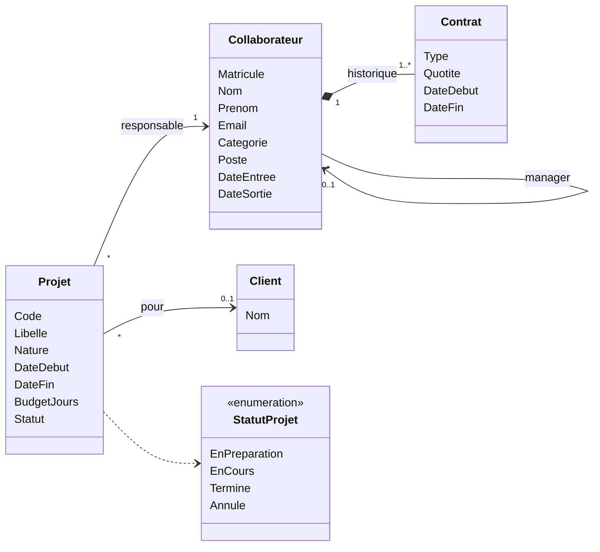
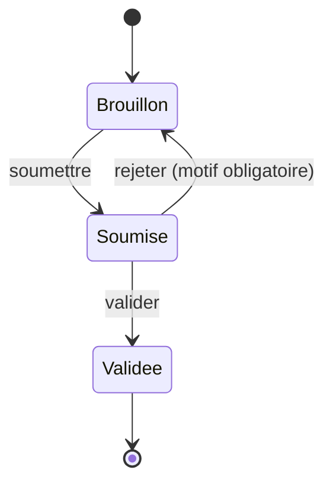

# Module 02 — Comprendre le besoin

> Pratiques vérifiées le 12 novembre 2026 — ce module s'appuie sur le [cahier des charges](../docs/cahier-des-charges.md) ; la syntaxe des diagrammes a été vérifiée dans la [documentation de Mermaid](https://mermaid.js.org/intro/).
> Ce module ne fait écrire **aucun code**. Les diagrammes qu'il contient ont été **validés le 12 novembre 2026** avec l'analyseur syntaxique de Mermaid 12.3.0. Leur affichage par GitHub n'a **pas** été vérifié sur un dépôt réel : l'étape 5 vous le fait contrôler dans le vôtre.

Votre poste est prêt, les bases de données démarrent. Il serait tentant d'ouvrir l'éditeur. Pourtant, la question la plus coûteuse d'un projet n'est pas « comment le coder ? » mais « qu'est-ce qu'on me demande, exactement ? ». Une quotité rangée au mauvais endroit ou un état oublié dans un cycle de validation se paient pendant des mois, dans la base, dans l'API et dans les écrans.

Ce module vous fait lire le [cahier des charges](../docs/cahier-des-charges.md) de Chronos comme un développeur doit le lire : crayon en main, pour en tirer un modèle, une liste de questions et un plan de travail.

## Objectifs

À la fin de ce module, vous saurez :

- repérer dans un cahier des charges les acteurs, le vocabulaire, les entités et leurs relations ;
- distinguer une entité d'un objet valeur, et un état d'une transition ;
- dessiner un modèle de domaine et un cycle d'états en Mermaid, dans un fichier Markdown ;
- dire, pour une règle de gestion, ce qu'il faut connaître pour la vérifier — et donc où elle vivra dans le code ;
- repérer une ambiguïté et la transformer en question pour le métier ;
- découper le travail en lots livrables et écrire un critère d'acceptation chiffré.

## Prérequis

- Module 00 : votre dépôt existe sur GitHub.
- Avoir lu une première fois, en entier, le [cahier des charges](../docs/cahier-des-charges.md). Comptez vingt minutes.

## Règles de gestion

**Toutes**, de RG-01 à RG-53 — en lecture. Ce module n'en met aucune en œuvre : il prépare le terrain pour les modules qui le feront.

## Notions

### Acteur et rôle

Un **acteur** est quelqu'un qui attend quelque chose du système. Le cahier des charges en nomme quatre (§ 2) et précise qu'une même personne peut cumuler plusieurs rôles. Un acteur n'est donc pas une catégorie de personnes : c'est une **casquette**.

### Langage commun

Le métier dit « quotité », « affectation », « intercontrat ». Si le code dit `WorkRatio`, `Assignment` et `BenchStatus`, chaque conversation avec le métier demande une traduction, et chaque traduction est une occasion de se tromper.

Le cours prend donc le parti du **langage commun** : les mots du cahier des charges sont les mots du code. La classe s'appellera `FeuilleDeTemps`, pas `Timesheet`. Deux conventions accompagnent ce choix : les identifiants s'écrivent **sans accents** (`Quotite`, `Prenom`), et le vocabulaire purement technique reste en anglais (`Dto`, `Endpoints`).

Documentation : [Ubiquitous Language](https://martinfowler.com/bliki/UbiquitousLanguage.html) (Martin Fowler)

### Entité et objet valeur

Deux collaborateurs peuvent porter le même nom et le même prénom : ce sont tout de même deux personnes. Un collaborateur est une **entité** : il a une identité, qui dure alors que ses données changent.

À l'inverse, « du 4 au 8 mai 2026 » n'a pas d'identité. Deux périodes aux mêmes dates sont la même période. C'est un **objet valeur** : seul son contenu compte.

Le test est toujours le même : *si deux objets ont exactement les mêmes données, est-ce le même objet ?* Oui : objet valeur. Non : entité.

Documentation : [concevoir un modèle de domaine](https://learn.microsoft.com/en-us/dotnet/architecture/microservices/microservice-ddd-cqrs-patterns/microservice-domain-model) (Microsoft), [Value Object](https://martinfowler.com/bliki/ValueObject.html) (Martin Fowler)

### Relation et cardinalité

Une **relation** lie deux entités : un projet est réalisé *pour* un client. Sa **cardinalité** dit combien : un projet a zéro ou un client (`0..1`) ; un client peut avoir plusieurs projets (`*`).

Les cardinalités se lisent dans les petits mots du texte : « un client **éventuel** », « **l'historique** des contrats », « **son** manager ».

### État et transition

Certains objets ont une vie. Une feuille de temps n'accepte pas les mêmes actions selon qu'elle est en cours de saisie ou déjà validée. On décrit cette vie par des **états**, en nombre fini, et des **transitions** : l'action qui fait passer d'un état à un autre, et qui a le droit de la déclencher.

### Où vit une règle

Toutes les règles de gestion ne se vérifient pas avec les mêmes informations. La question à poser est : *que faut-il connaître pour dire si la règle est respectée ?*

| Il suffit de connaître… | Exemple | Conséquence |
| --- | --- | --- |
| les données d'**un seul objet** | RG-12 : les deux dates d'un projet | L'objet se protège lui-même. Aucune base n'est nécessaire pour le tester. |
| **plusieurs objets qu'on vous fournit** | RG-22 : jours ouvrés, absences, quotité | Un calcul pur, testable avec des exemples chiffrés. |
| **l'ensemble des données**, ou **qui agit** | RG-10 : aucun autre projet n'a ce code | Il faut interroger la base, ou connaître l'utilisateur. |

Ce classement décidera, module après module, de l'endroit où chaque règle sera codée et de la façon de la tester.

### Ambiguïté

Un cahier des charges est écrit par des personnes pour qui le métier est évident. Il contient donc des mots jamais définis, des cas limites non prévus, des phrases qui admettent deux lectures. **Ce n'est pas un défaut du document : c'est la norme.**

Le travail du développeur n'est pas de choisir en silence la lecture qui l'arrange. Il est de **repérer** l'ambiguïté, de formuler les lectures possibles, et de poser la question.

### Lot et critère d'acceptation

Un **lot** est un morceau de l'application qu'on peut livrer et montrer : il apporte quelque chose à un acteur, même si le reste n'existe pas encore.

Un **critère d'acceptation** dit comment on saura qu'une règle est respectée. Sa forme la plus utile part d'un exemple chiffré : *étant donné* une situation, *quand* il se passe ceci, *alors* on observe cela. Un tel critère se transforme presque mot pour mot en test automatisé.

Documentation : [Given When Then](https://martinfowler.com/bliki/GivenWhenThen.html) (Martin Fowler)

### Mermaid

Mermaid décrit un diagramme par du texte. GitHub l'affiche dans les fichiers Markdown, les tickets et les *pull requests* : le diagramme se versionne, se relit et se compare comme du code.

Documentation : [diagramme de classes](https://mermaid.js.org/syntax/classDiagram.html), [diagramme d'états](https://mermaid.js.org/syntax/stateDiagram.html), [diagrammes dans GitHub](https://docs.github.com/en/get-started/writing-on-github/working-with-advanced-formatting/creating-diagrams)

## Pas à pas

Le pas à pas traite les **collaborateurs et les projets** (§ 4.1 et 4.2), puis le cycle de la **feuille de temps**. Le reste du périmètre est pour vous.

### 1. Préparer le document de travail

Copiez `docs/cahier-des-charges.md` du dépôt du cours dans le vôtre, au même emplacement. Créez à côté un fichier `docs/modele.md` : tout ce que vous produirez dans ce module y sera consigné.

Relisez ensuite les § 4.1 et 4.2 en marquant trois choses : les **noms** (candidats à devenir des entités ou des données), les **verbes** (les actions) et les **contraintes** (« unique », « obligatoirement », « ne peut pas »).

### 2. Relever les acteurs

Pour chaque acteur du § 2, notez ce qu'il fait et les règles qui encadrent ses actions. Pour le premier :

| Acteur | Ce qu'il fait | Règles qui le concernent |
| --- | --- | --- |
| Collaborateur | Consulte son planning, saisit ses temps, pose ses absences. | RG-30 à 35, RG-40, RG-50 |

Un point demande de l'attention : le mot « collaborateur » désigne ici **deux choses**. C'est une personne employée par la société (§ 3), et c'est un rôle dans l'application (§ 2). Un manager est aussi une personne employée : il aura sa fiche, ses temps, ses absences. Notez-le ; cela évitera plus tard de créer une classe `Manager`.

### 3. Tenir le glossaire

Reprenez le vocabulaire du § 3 et ajoutez, pour chaque terme, le nom qu'il portera dans le code.

| Terme métier | Identifiant | Remarque |
| --- | --- | --- |
| Collaborateur | `Collaborateur` | |
| Quotité | `Quotite` | Pas d'accent dans un identifiant. |
| Feuille de temps | `FeuilleDeTemps` | Les mots sont accolés, chacun avec sa majuscule. |
| Taux d'allocation | `TauxAllocation` | |

Complétez le tableau pour tous les termes du § 3. Si un mot du § 4 ou du § 5 n'y figure pas, ajoutez-le et cherchez sa définition : vous venez peut-être de trouver une ambiguïté (étape 8).

### 4. Trier entités, objets valeur et simples données

Passez chaque nom relevé à l'étape 1 au test de l'identité.

- **Collaborateur**, **client**, **projet** : deux projets de même libellé restent deux projets. Ce sont des entités.
- **Matricule**, **nom**, **budget en jours** : ce sont des données d'une entité, pas des objets à part.
- **Nature** d'un projet (facturable ou interne), **statut** : une liste fermée de valeurs. Ce sera une énumération.
- **Dates de début et de fin** : la paire revient pour le projet, et vous la retrouverez ailleurs dans le cahier. Deux paires identiques sont la même période : c'est un objet valeur, `Periode`. Savoir si une date est *dans* une période, ou si deux périodes *se chevauchent*, sont des questions que plusieurs règles poseront.

Reste un cas instructif. Le § 4.1 range « type de contrat » et « quotité » parmi les informations de la fiche du collaborateur. La ligne suivante ajoute : « conserver l'historique des contrats (un changement de quotité ne doit pas fausser le passé) ».

Si la quotité était une donnée du collaborateur, la modifier réécrirait le passé : la capacité de l'an dernier serait recalculée avec la quotité d'aujourd'hui. La quotité appartient donc à un **contrat**, qui a une date de début et une date de fin, et un collaborateur a **plusieurs** contrats successifs. Un nom discret dans une parenthèse vient de créer une entité.

### 5. Dessiner le premier diagramme

Dans `docs/modele.md`, ouvrez un bloc de code dont le langage est `mermaid` et décrivez ce que vous venez d'établir. Voici le diagramme de référence pour cette partie du périmètre :



Si vous lisez ce module sur GitHub, vous voyez un dessin ; ouvrez le fichier dans votre éditeur pour en lire le texte. La syntaxe tient en peu de choses :

- `class Projet { … }` déclare une classe et ses données, une par ligne ;
- `<<enumeration>>` signale une liste fermée de valeurs ;
- `-->` est une association, `*--` une composition : un contrat n'existe pas sans son collaborateur ;
- les cardinalités s'écrivent entre guillemets de part et d'autre de la flèche, le libellé après les deux-points.

Chaque trait se justifie par une phrase du cahier :

- **`Projet "*" --> "0..1" Client`** : « client **éventuel** ». La cardinalité dit qu'un projet *peut* ne pas avoir de client ; elle ne dit pas *quand*. C'est RG-11 qui le dit, et aucun trait ne peut l'exprimer : il restera une règle à coder.
- **`Collaborateur "*" --> "0..1" Collaborateur`** : le manager d'un collaborateur est lui-même un collaborateur, et le sommet de la hiérarchie n'en a pas.
- **`Collaborateur "1" *-- "1..*" Contrat`** : au moins un contrat. Le cahier ne le dit pas expressément ; c'est une lecture, et donc une question à noter.
- **`Categorie`** n'apparaît dans aucune liste du § 4.1. Elle vient de la définition du § 3 — « consultant ou salarié interne » — et de RG-25, qui ne s'applique qu'aux consultants.

Poussez le fichier et ouvrez-le sur GitHub : le diagramme doit s'afficher. S'il est remplacé par un message d'erreur, la syntaxe est fautive ; l'[éditeur en ligne de Mermaid](https://mermaid.live/) aide à trouver la ligne en cause. Pour savoir quelle version de Mermaid utilise GitHub, placez le seul mot `info` dans un bloc `mermaid`.

### 6. Décrire le cycle d'une feuille de temps

RG-34 décrit un cycle : « *brouillon → soumise → validée* ou *rejetée*. Une feuille rejetée revient à l'état de brouillon avec le motif du rejet. »

La première phrase semble annoncer quatre états. La seconde corrige : une feuille rejetée **redevient** un brouillon. « Rejetée » n'est pas un endroit où la feuille séjourne, c'est un événement qui la renvoie en arrière en lui attachant un motif. Il y a donc trois états et trois transitions.

Le texte à écrire :

```text
stateDiagram-v2
    [*] --> Brouillon
    Brouillon --> Soumise : soumettre
    Soumise --> Validee : valider
    Soumise --> Brouillon : rejeter (motif obligatoire)
    Validee --> [*]
```

Et ce que GitHub en fait :



`[*]` marque le début et la fin ; chaque flèche porte, après les deux-points, l'action qui la déclenche.

Complétez le diagramme par un tableau : c'est lui qui servira au moment de coder.

| Transition | De | Vers | Qui | Règles |
| --- | --- | --- | --- | --- |
| soumettre | Brouillon | Soumise | le collaborateur | RG-34 |
| valider | Soumise | Validee | son manager ou un gestionnaire RH, jamais lui-même | RG-34, RG-36 |
| rejeter | Soumise | Brouillon | les mêmes ; un motif est exigé | RG-34, RG-36 |

Le diagramme répond aussi à RG-35 : dans quels états la feuille est-elle modifiable par le collaborateur ? Un seul. Et il fait apparaître une question que le texte ne pose pas : une feuille validée peut-elle être rouverte, pour corriger une erreur ? Dans ce diagramme, rien ne ramène en arrière depuis `Validee`. Notez la question.

### 7. Classer les règles

Appliquez à RG-01 à RG-13 la question de la notion « Où vit une règle ».

| Règle | Ce qu'il faut connaître | Catégorie |
| --- | --- | --- |
| RG-02 | Les deux dates du collaborateur. | Un seul objet |
| RG-03 | La quotité du contrat. | Un seul objet |
| RG-11 | La nature et le client du projet. | Un seul objet |
| RG-12 | Les deux dates du projet. | Un seul objet |
| RG-13 | Le statut du projet. | Un seul objet : le projet sait s'il accepte encore du travail. |
| RG-01 | Les matricules et adresses de **tous** les collaborateurs. | L'ensemble des données |
| RG-10 | Les codes de **tous** les projets. | L'ensemble des données |
| RG-04 | Toute la chaîne des managers, de proche en proche. | L'ensemble des données |
| RG-05 | L'existence de saisies, d'affectations ou d'absences liées. | L'ensemble des données |

Ce tableau annonce la suite : les cinq premières règles seront codées et testées au module 04, sans base de données ; les quatre autres attendront qu'il y en ait une.

### 8. Repérer les ambiguïtés

Trois endroits où chercher :

- **les mots sans définition** — utilisés dans les § 4 et 5, absents du § 3 ;
- **les cas limites** — le premier jour, le dernier, zéro, un changement en cours de période ;
- **les exemples** — refaites chaque calcul vous-même.

Commençons par un mot. Le § 4.1 fait filtrer les collaborateurs par « équipe » ; RG-51 parle de l'équipe « directe et indirecte ». Le § 3 ne définit pas l'équipe. Est-ce une entité, avec un nom et des membres ? Ou simplement l'ensemble des collaborateurs qui ont le même manager ? Les deux lectures donnent deux modèles différents.

Passons à l'exemple du § 7, qui signale lui-même que quelque chose mérite discussion. Relisez deux lignes :

- la définition du **taux d'allocation** (§ 3) : « part de la **capacité du collaborateur** réservée à un projet » ;
- la règle **RG-23** : « somme, pour chaque affectation, des **jours ouvrés couverts** × taux d'allocation ».

La capacité de Camille et le nombre de jours ouvrés de la semaine ne sont pas le même nombre. « 50 % » ne désigne donc pas la même quantité selon la phrase qu'on suit. Calculez la charge planifiée de Camille selon chacune des deux lectures, puis le taux de charge. Les deux résultats conduisent-ils au même signalement pour son manager ?

**Ne tranchez pas.** Ce n'est pas au développeur de décider seul ce que « 50 % » veut dire, et le cours prendra cette décision au module 09, tests à l'appui. Consignez seulement ce que vous avez trouvé :

| Où | Ce qui est ambigu | Lectures possibles | Question à poser |
| --- | --- | --- | --- |
| § 4.1, RG-51 | « équipe » n'est pas définie. | Une entité à part ; ou les collaborateurs d'un même manager. | « Une équipe a-t-elle une existence propre, un nom ? Un collaborateur peut-il changer d'équipe sans changer de manager ? » |
| § 7, RG-23 | La base du taux d'allocation. | *(vos deux lectures, avec les chiffres obtenus)* | *(votre question)* |

### 9. Découper en lots

Un bon lot se montre : à la fin, un acteur peut faire quelque chose qu'il ne pouvait pas faire avant. Un bon découpage respecte aussi les dépendances : on ne peut pas affecter un collaborateur à un projet tant que ni l'un ni l'autre n'existe.

Le premier lot s'impose :

| Lot | Ce qu'un acteur peut faire à la fin | Règles | Dépend de | Modules du cours |
| --- | --- | --- | --- | --- |
| 1 — Référentiel | Le gestionnaire RH tient les fiches des collaborateurs et leurs contrats ; on crée des clients et des projets. | RG-01 à 05, RG-10 à 13 | — | API : 03, 04, 06, 08. Interface : 13 à 17. |

Le [plan de cours](README.md) indique, module par module, les règles traitées : il vous servira à remplir la dernière colonne des lots suivants. Vous verrez que certains modules ne livrent aucune fonctionnalité — tests, intégration continue, conteneurs. Ce ne sont pas des lots : ce sont les moyens de livrer les lots sans crainte.

### 10. Écrire un critère d'acceptation

Le § 6 exige que les calculs de capacité et de charge soient couverts par des tests. Un test commence par un critère, et un critère commence par des chiffres. Le § 7 en fournit pour RG-22 :

```text
Étant donné la semaine du lundi 4 au vendredi 8 mai 2026, dont le vendredi 8 est férié,
  et Camille, employée à 80 %, en congé approuvé le lundi 4,
Quand on calcule la capacité de Camille sur cette semaine,
Alors on obtient 2,4 jours.
```

Tout y est : la situation de départ, sans rien de sous-entendu ; une seule action ; un résultat que n'importe qui peut vérifier à la main. « Le calcul de capacité est correct » n'est pas un critère : rien ne permet de dire s'il est rempli.

Un seul exemple ne suffit pas à cerner une règle. On en fait varier les données une à une : et sans absence ? Et à temps plein ? Et si l'absence ne dure qu'une demi-journée ?

## À vous

1. **Compléter les acteurs.** Terminez le tableau de l'étape 2 pour le manager, le gestionnaire RH et l'administrateur. Quelles règles ne concernent qu'un seul acteur ? Laquelle interdit quelque chose à *tout le monde* ?

2. **Étendre le modèle.** Ajoutez au diagramme de classes ce que décrivent les § 4.3 à 4.6 : affectations, feuilles de temps, saisies, absences, types d'absence, jours fériés — avec leurs données, leurs relations et leurs cardinalités. Trois questions pour vous guider. Une feuille de temps couvre une semaine : quelle donnée unique suffit à désigner une semaine sans équivoque ? Une absence peut commencer un lundi après-midi et finir un mercredi midi : que faut-il ajouter à ses deux dates ? RG-05 n'efface jamais un collaborateur qui a des données liées : quelle donnée cela ajoute-t-il à sa fiche ?

3. **Dessiner le cycle d'une absence.** Faites pour RG-40 ce que l'étape 6 a fait pour RG-34 : diagramme d'états et tableau des transitions. Combien d'états, cette fois ? Votre diagramme doit vous obliger à répondre à deux questions que le texte laisse ouvertes : une absence déjà approuvée peut-elle être annulée ? Et que devient RG-43 dans votre tableau ?

4. **Classer le reste des règles.** Prolongez le tableau de l'étape 7 de RG-20 à RG-53, avec les trois catégories de la notion « Où vit une règle ». Pour chaque règle de la troisième catégorie, précisez ce qui manque : d'autres données, ou l'identité de celui qui agit.

5. **Chasser les ambiguïtés.** Ajoutez au moins cinq lignes au tableau de l'étape 8. Des pistes, sans les réponses : RG-25 et un consultant absent toute la semaine ; la « sous-charge » du § 4.3 ; RG-22 quand la quotité change au milieu de la période ; « archivé » dans RG-05 ; le temps « consommé » comparé au budget (§ 4.4). Pour chacune, formulez la question telle que vous la poseriez à un gestionnaire RH, sans un mot de technique.

6. **Finir le découpage et chiffrer.** Complétez le tableau des lots jusqu'à couvrir toutes les règles, en le reliant aux modules du cours. Puis écrivez six critères d'acceptation au format de l'étape 10 : trois variantes pour RG-22, un pour RG-31, un pour RG-12 — et, pour RG-23, **deux critères concurrents** sur l'exemple de Camille, un par lecture trouvée à l'étape 8. Ils ne peuvent pas être vrais tous les deux : c'est exactement ce que vous apporterez au module 09.

## Critères de réussite

- Votre dépôt contient `docs/cahier-des-charges.md` et `docs/modele.md`.
- Sur GitHub, `docs/modele.md` affiche un diagramme de classes et deux diagrammes d'états, sans message d'erreur.
- Chaque terme du § 3 figure dans votre glossaire avec son identifiant, sans accent.
- Chaque entité de votre diagramme se rattache à une phrase du cahier que vous savez citer ; chaque cardinalité aussi.
- Les règles RG-01 à RG-53 sont toutes classées, et toutes rattachées à un lot.
- Votre tableau d'ambiguïtés compte au moins sept lignes, chacune avec une question compréhensible par quelqu'un qui ne programme pas. Celle du § 7 y figure, **non tranchée**.
- Vos critères d'acceptation contiennent des dates et des nombres, et vous avez vérifié chaque résultat à la main.
- Le dépôt du cours marque l'état attendu par le tag `module-02` : comparez avec `git diff module-01 module-02`. Votre modèle n'a pas à être identique à celui de référence ; vous devez pouvoir expliquer chaque différence en séance.

## Pièges

| Ce qu'on voit / ce qu'on fait | Pourquoi c'est un problème | À faire à la place |
| --- | --- | --- |
| Partir des écrans, ou des tables de la base | On modélise une solution avant d'avoir compris le problème ; les règles se retrouvent éparpillées. | Partir du vocabulaire et des règles. |
| Traduire le métier en anglais dans le code (`Employee`, `Timesheet`) | Le lien avec le cahier des charges est perdu ; chaque échange avec le métier demande une traduction. | Les mots du cahier, sans accents. |
| Une classe `Manager` qui hérite de `Collaborateur` | Un manager est un collaborateur qui a un rôle de plus, et les rôles se cumulent : l'héritage ne sait pas le représenter. | Une seule entité ; le rôle est une autre information. |
| La quotité rangée sur le collaborateur | La modifier fausse tous les calculs du passé. | Un contrat daté, et un historique. |
| Un état « Rejetée » où la feuille resterait | Le cahier dit qu'elle redevient un brouillon ; un état de plus, ce sont des cas de plus à gérer partout. | Une transition, et un motif conservé. |
| Trois booléens `EstSoumise`, `EstValidee`, `EstRejetee` | Huit combinaisons possibles pour trois situations réelles : le code doit se défendre contre toutes les autres. | Un seul statut, à valeurs énumérées. |
| Trancher une ambiguïté en codant | La décision est prise sans que personne le sache, et découverte en recette. | L'écrire, la poser, attendre la réponse. |
| « Le calcul est correct », « l'écran est ergonomique » | Critère invérifiable. | Un exemple, des chiffres, un résultat attendu. |
| Modéliser la paie ou la facturation « tant qu'on y est » | Le § 4.7 les exclut. | Lire le hors-périmètre avec autant de soin que le périmètre. |
| Un diagramme dessiné dans un outil graphique et collé en image | Impossible à comparer d'une version à l'autre ; il cesse vite d'être à jour. | Mermaid, dans un fichier Markdown versionné. |
| Un lot « toute la base », puis « toute l'API », puis « tous les écrans » | Rien n'est montrable avant la fin. | Des lots qu'un acteur peut utiliser. |

## Pour la séance

- Le cours écrit le métier en français dans le code. Qu'y gagne-t-on ? Qu'y perd-on, par exemple le jour où l'équipe accueille un développeur qui ne parle pas français ?
- La quotité est un nombre entre 0,10 et 1. Faut-il en faire un objet valeur, comme la période ? Qu'est-ce qui ferait pencher la balance ?
- Le plan de cours construit toute l'API avant de commencer l'interface. Est-ce cohérent avec l'idée de lot livrable ? Quelles raisons peuvent le justifier pour un apprentissage, et que feriez-vous sur un vrai projet ?
- Parmi vos ambiguïtés, lesquelles pouvez-vous lever seul en relisant le cahier, et lesquelles exigent une réponse du métier ? Comment faire la différence ?
- Jouez la scène : le mentor tient le rôle du gestionnaire RH, vous lui posez vos questions. Lesquelles a-t-il comprises du premier coup ?
- Qui devrait écrire les critères d'acceptation : le métier, le développeur, les deux ? À quel moment ?
- Votre modèle diffère sans doute du modèle de référence. Quelles différences sont des erreurs, et lesquelles sont des choix défendables ?

## Pour aller plus loin

- [Concevoir un modèle de domaine](https://learn.microsoft.com/en-us/dotnet/architecture/microservices/microservice-ddd-cqrs-patterns/microservice-domain-model) : entités, objets valeur et agrégats — la notion d'agrégat éclairera le lien entre une feuille de temps et ses saisies. Le chapitre vient d'un guide sur les microservices, que Chronos n'est pas ; les définitions valent quand même.
- [Documentation de Mermaid](https://mermaid.js.org/intro/) : les autres types de diagrammes, dont le diagramme de séquence, utile pour décrire un échange entre l'interface et l'API.
- [Jalons GitHub](https://docs.github.com/en/issues/using-labels-and-milestones-to-track-work/about-milestones) : suivre l'avancement de vos lots avec des tickets regroupés par jalon.
- Suite dans le cours : le module 04 traduit en C# la première partie de ce modèle ; le module 09 tranche l'ambiguïté du § 7 ; le module 10 code les deux cycles d'états.
